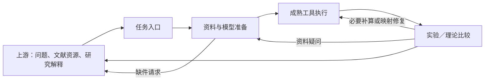

# 仿真 Skills：接收任务，执行工况，验证结果

这组 Skills 是 ResearchFlow 的仿真执行层。上游负责研究问题、文献检索/下载和机制解释；仿真层把已经交付的条件、资料和命令转成实际运行与可复核对照。研究者可直接提交一个完整工况，也可让准备角色先从论文里提取参数与实验数据。

## 四个入口

| Skill | 什么时候用 | 交付什么 |
|---|---|---|
| `simulation-project-orchestrator` | 一个完整仿真任务，或需要协调准备、运行与验证 | 当前任务、路由、结果索引、反馈处置 |
| `simulation-evidence-preparation` | 文献/数据已有，但物理条件与比较数据尚未整理 | 有来源的模型路径、参数、参考数据、具体缺件请求 |
| `simulation-tool-execution` | 工况、模型和所需输出已定义，需要计算或补算 | 原生输入、日志、原始场、运行 manifest、字段索引 |
| `simulation-result-validation` | 结果已有，需要实验/理论对照或偏差诊断 | 同观测定义的比较、必要数值核验、用途结论、修复请求 |



完整任务按需经过三个阶段，已准备任务可直接执行，已有结果可直接验证。Skill 文件是指导，真正的子代理和 MCP 调用由宿主完成。每个子代理收到其职责 Skill、相关原件、输出路径和返回条件；不会要求所有角色先读路由器和全部研究历史。小任务允许合并职责，重要结论由独立验证者复核。

## 简单开始

从宿主实际发现位置安装这四个目录。仓库集成安装仍用：

```powershell
python scripts/install.py --update
```

它同时安装仓库治理 Skill 与角色；仅需要仿真能力时可把四个 `skills/simulation-*` 目录一起复制到宿主 Skills 目录。保持同级目录，跨 Skill 导航使用相对路径。完成后启动新的 Codex 运行。

需要运行科学对话的追加或审计脚本时，安装可选依赖：`python -m pip install -e ".[simulation]"`。该依赖提供JSON Schema校验；ResearchFlow核心记录运行时仍仅使用标准库。仓库完整测试也需要这一可选依赖。

直接给出目标、工况、可观测量、资料路径、工具约束和所需结果即可，不需要先填写长表：

> 用 $simulation-project-orchestrator 执行这三组稳态传热工况。论文和数据在 `resources/`，实验出口温度用于验证；先整理物性和边界条件，缺件向上游资源角色提出请求。使用本机可用的成熟求解器，输出原始温度场、各工况出口温度和验证对比。任务预算两小时。

已有闭合定义时：

> 用 $simulation-tool-execution 按 `conditions.csv` 和现有模型补算工况 B/C，复用已确认的工具配置，保存原始结果并更新索引。

已有结果时：

> 用 $simulation-result-validation 比较 `runs/` 与 `experimental-data.csv`。按论文给出的测点区域和时间窗对齐观测，说明各工况是否支持出口温度预测用途；需要资料或补算时具名返回。

原件、已有模型文件或原生命令可以直接引用，不强制重复创建同义文件。参数表/比较表只有在程序消费或复核需要时单独生成。

## 文献与工具边界

准备角色消费上游已经交付的论文、补充材料、表格、图像或代码，提取实验条件、模型参数、验证观测和成熟模型路径。资料缺失时请求包含：物理工况、具体参数/观测、所需资源形式、用途、受影响计算或结论、返回目录。上游决定使用哪一个检索/下载 Skill；仿真层不承担检索认证流程。

同实验对齐的是物理系统、材料/几何、载荷/初边值条件和测量定义。论文网格、时间步与数值格式是参考，不是普遍硬要求。执行者根据成熟软件、目标量和预算选择计算参数；只在会改变当前判断时请求有界细化或修复。物理定义不完整时不能任意补参数；实验数据缺失可以影响验证范围而不阻断已经闭合的计算。

执行以真实可用 MCP 求解工具为优先路径。连接器存在不等于求解器已安装、版本适用或工具已暴露；执行者检查实际能力。没有对应 MCP 时，允许明确记录的原生 CLI、Python 或 WSL 路径。Skills 不捆绑求解器、商业许可证或全部科学库，也不提供通用 MCP server。必要的代码用于原生输入、工具调用与后处理；新算法研发和机制探索交回上游。

## 反馈、验证与结束

发现偏差的角色先检查本职，再向负责角色提出可定位问题：哪个工况/文件，已查什么，需要谁提供什么证据或动作，会影响哪个结论。回复保留已解决与未解决部分，请求者解释答复并复测原症状。只重做失效部分；两次相同症状且无新判断时由协调者重新选下一步。

执行成功、数值核验、实验比较与用途有效性分别记录。理论 benchmark 可以核验方程实现和限定理论用途，不能称实验验证。用于校准的数据不能同时充当独立验证；未知不确定度明确标未知。报告围绕请求的物理量、工况对比和用途呈现，数值检查提供支撑，不自动展开机制论文。

当前结果索引与各阶段产物承担日常上下文。恢复只带有效文件、当前事实、未决项、已排除原因和下一动作；重要争议可使用路由器内的可选对话账本。已使用 ResearchFlow 的项目复用其状态，不再强制建立另一套治理对象。

## 维护与迁移

当前权威源是仓库 `skills/`，安装目录是运行副本。旧的单体参考、机制研究指令和不再消费的 schema 由 `templates/skill-migrations.json` 明列退役。`--update` 先备份这些文件到发现目录之外的 `researchflow-migration-backup`，再更新与删除清单内文件；未列入的用户文件保留。重复更新不会重复备份，历史内容冲突会在写入前报错。

早期 `docs/simulation-audit.md` 和历史行为记录描述当时的单体版本，保留用于追溯；当前入口、职责和安装范围以本文及四个 Skill 为准。结构依据是用户提供的 MP 自检指导：明确入口、渐进加载、单一维护来源、实际职责边界和行为验收；这些是对 Codex 的迁移，不表示 MP 的运行配置可以直接复用。
